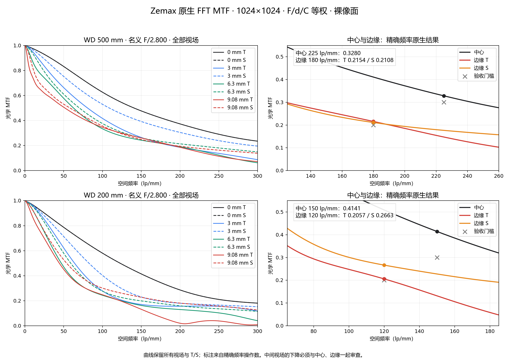
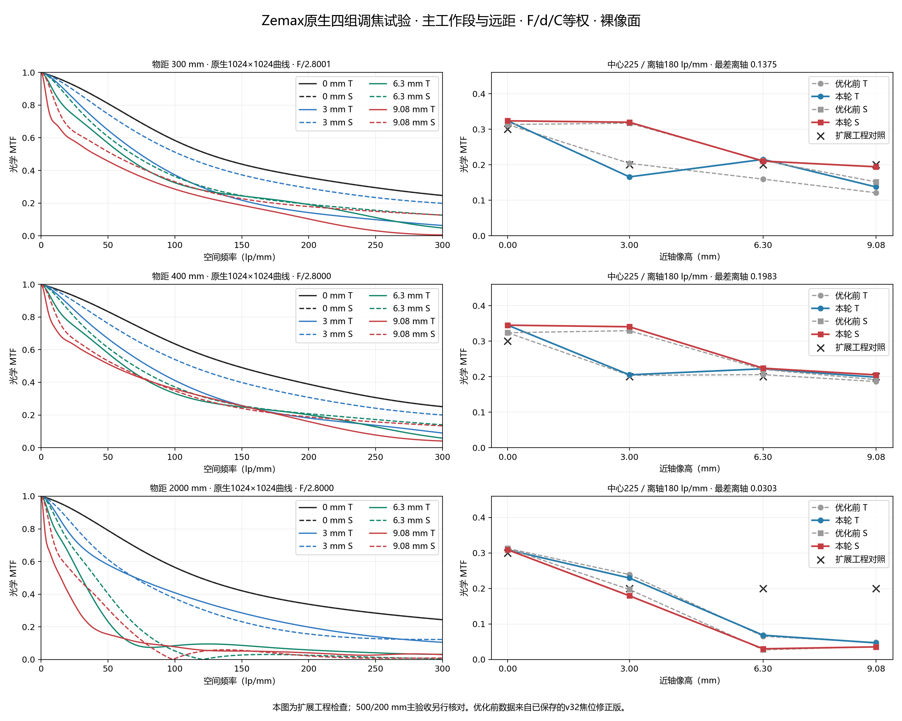

# codex-4-zemax

**AI 光学自动化项目展示 · Codex + Python + ZOSPy + Ansys Zemax OpticStudio**

以 **35 mm F/2.8 工业镜头**为案例，记录从公开专利处方复建、材料匹配，到原生优化、多物距复核、温度补偿和结果归档的工作流。仓库提供可打开的 Zemax 模型、自动化脚本、结构化分析结果及原生 MTF 图。

AI 辅助组织需求、编写脚本、安排试验与整理证据；ZOSPy 连接并控制 OpticStudio；标为“原生”的优化与分析由 Zemax 实际执行。独立 Python 光学计算用于交叉检查与候选搜索。

> **当前状态：阶段性研究候选，完整需求尚未全部验收。** v31 是已验证子集的审查基线；v35 是最新四组浮动调焦试验，尚未替换基线。发布于 2026-10-19，所展示光学结果来自截至 2026-10-16 的项目记录；本次发布没有重新执行光学仿真。

## 先看这几个文件

| 入口 | 内容 |
|---|---|
| [仿真文件包 ZIP](packages/codex-4-zemax-simulation-bundle.zip) | 模型、脚本、CSV/JSON、研究记录与结果图；下载后完整解压 |
| [v31 审查模型](design_35mm_f28/candidate_v31_thermal_probe_review.zos) | 常温 500/200/800 mm 与无穷远配置 |
| [v35 最新试验模型](design_35mm_f28/candidate_v35_native_fourgroup.zos) | 7 配置、四组浮动调焦试验 |
| [设计状态与验收记录](design_35mm_f28/设计状态与验收记录.md) | 已验证范围、数值证据与未完成事项 |
| [运行与复核指南](docs/REPRODUCE.md) | 环境配置、模型打开方式及原生复核命令 |
| [自动化流程](docs/WORKFLOW.md) | AI、Python、ZOSPy 与 Zemax 的分工 |

## 已验证基线：原生 MTF

条件：裸像面、F/d/C 等权、名义 F/2.8、实际 CDGM/NHG 玻璃、固定镜片口径及真实光阑瞄准。下表来自 v31 历史原生验收记录。

| 物距 mm | 中心 / 离轴频率 lp/mm | 中心 MTF | 边缘 T / S | 全离轴最低 MTF | 最大畸变 |
|---:|---|---:|---|---:|---:|
| 500 | 225 / 180 | 0.32804 | 0.21543 / 0.21083 | 0.20971 | 0.1192% |
| 200 | 150 / 120 | 0.41411 | 0.20569 / 0.26633 | 0.20569 | 0.5800% |
| 800 | 225 / 180 | 0.31708 | 0.21370 / 0.24017 | 0.21370 | 0.1271% |

500/200 mm 采用项目暂定中心 MTF ≥ 0.30、离轴 ≥ 0.20 门槛；800 mm 为工程对照。[原生验收 JSON](design_35mm_f28/candidate_v31_thermal_probe_native_acceptance.json) / [验收摘要](design_35mm_f28/candidate_v31_thermal_probe_acceptance_summary.json)。



v31 在 500/200 mm、−20°C 与 +60°C 下完成主动三组调焦补偿的已检查 MTF 子集，采用 23 ppm/K 垫圈假设。[温度补偿证据](design_35mm_f28/candidate_v31_thermal_probe_thermal_compensated_native.json)。这些结论不自动适用于 v35 或全部物距。

## 最新试验：四组浮动调焦

v33/v34 通过 ZOSPy 调用 Zemax 内置 DLS，分别完成 68 与 78 变量的联合优化；v35 固定 v34 公共处方，增加 L6 独立浮动，对 300/400/2000 mm 分别进行 5 变量、10 轮原生焦位优化。300/400 mm 采用改善后的焦位；2 m 未改善最差离轴，恢复父模型焦位。



[v35 试验记录](design_35mm_f28/candidate_v35_native_fourgroup_review.md)明确列出每个配置的证据来源。300/400 mm 最差离轴 MTF 分别为 0.13751 / 0.19830，2 m 为 0.03026，扩展物距的高频离轴像质仍需改善。新四组模型的温度、连续调焦、机构、制造公差、色边与杂散光仍待验证。

## 项目内容

```text
design_35mm_f28/        模型版本、优化与复核脚本、MTF、温度及几何证据
zemax_import/           CN110703413B 实施例 3 复建与一致性审计
patent_research_35mm/   公开专利参考资料与筛选记录
zospy_*_results/        API、中文报告适配与分析结果
zospy_zh.py             ZOSPy 中文报告适配器
docs/                  工作流、运行指南与来源说明
tools/verify_bundle.py  离线包完整性、语法与入口链接检查
packages/              可直接下载的完整仿真文件包
```

原始 `.zos` 模型逐字节保留；发布副本去除了缓存、ZDA 分析会话文件、个人镜头备份与机器清理记录。导出文本中的本机路径已归一化，原始仿真工作目录未修改。脚本支持 `OPTICSTUDIO_DIR`，玻璃目录可通过 `ZEMAX_GLASSCAT_DIR` 配置。

## 快速开始

无需运行脚本即可浏览 README、PNG、CSV/JSON。使用 OpticStudio 24R1 打开 v31 或 v35 的 `.zos` 文件可检查模型；运行自动化需要 Windows、可用的 OpticStudio / ZOS-API 许可和 Python 环境。

```powershell
python -m pip install -r requirements.txt
$env:OPTICSTUDIO_DIR = 'D:\Zemax'
$env:ZEMAX_GLASSCAT_DIR = "$env:USERPROFILE\Documents\Zemax\Glasscat"
python tools/verify_bundle.py
```

原生脚本会调用许可软件并写入结果，运行前请按[复核指南](docs/REPRODUCE.md)建立独立工作副本。仓库中的历史结果不依赖本机重新运行才能查看。

## English overview

An AI-assisted optical automation showcase using Codex, Python, ZOSPy and Ansys Zemax OpticStudio. The 35 mm F/2.8 case study includes patent reconstruction, native DLS optimization, multi-configuration MTF review, thermal focus compensation and independent geometry checks. Native results are computed by Zemax. v31 is the reviewed baseline for a verified subset; v35 is an experimental four-group focus candidate. Full design acceptance, continuous focusing, tolerancing and stray-light validation remain incomplete.

See [sources and publication scope](docs/SOURCES.md) for third-party references and software prerequisites.
