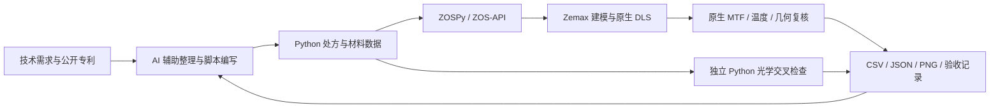

# AI 光学自动化工作流

1. 以公开数值表重建处方，核对多配置、材料、光阑和单位。
2. 交叉检查有效焦距和公开描述。CN110703413B 实施例 3 的公开数值复建约为 29.87 mm，没有将导入成功当作 35 mm 目标达成。
3. 匹配真实玻璃，保留候选搜索、原生优化与最终复核的独立证据。
4. 使用 OpticStudio 内置 DLS 优化。ZOSPy 负责变量、评价函数、执行和结果导出。
5. 对保存文件重新打开复核，并检查不同采样、物距、温度与独立几何约束。
6. 保留基线与实验分支，记录采用和放弃的焦位及尚未完成的验收项目。

关键入口：[原生联合优化](../design_35mm_f28/native_resume_joint.py)、[四组焦位优化](../design_35mm_f28/native_fourgroup_focus.py)、[保存模型独立审计](../design_35mm_f28/native_audit_multiconfig.py)、[独立几何检查](../design_35mm_f28/audit_native_geometry.py)。

仓库没有通用聊天代理服务或模型权重；它展示的是 AI 参与光学工程流程后留下的模型、自动化代码和可核查证据。
